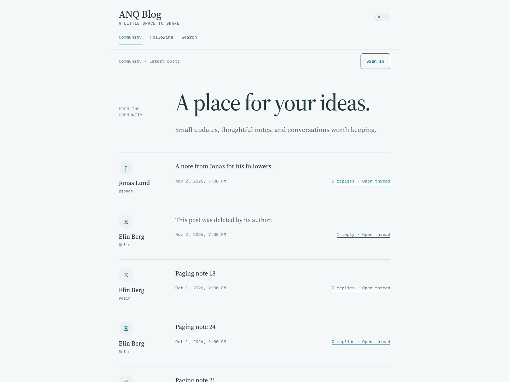

# ANQ Blog

[](https://github.com/adaalrf/anq-blog/actions/workflows/check.yml)

A small community blog, built to understand how one actually works.

[Browse the demo](https://blog.demo.adaalrf.dev) · [Read the case study](https://adaalrf.dev/work/anq-blog/)



The demo is open to browse and holds fictional conversations. Publishing needs an
account.

## Why it exists

Posting text is the easy part of a community site. The interesting questions come
afterwards. What should happen when two open tabs edit the same post? When someone
deletes a post that already has replies? When a moderator removes something, but
there still needs to be a record of why?

This project works through those questions by building the whole thing rather than
reaching for an existing platform. It isn't meant to replace one, but if it's useful
to someone, that's a good thing.

## What it does

- Anyone can read the feed, profiles, threads and search.
- Members can publish short plain-text posts and reply to each other.
- Members can follow each other, with a feed of the people they follow.
- An edit is stopped if the post changed after it was opened.
- A deleted post leaves a placeholder, so its replies keep their context.
- Members can hide a post for themselves or report it, and moderators record a
  reason for each decision.

## How it works

The feed, a profile and a thread all use the same post component, so a post behaves
the same everywhere it appears. Each post carries a version number, and the server
refuses a write based on an older one, which is what stops two open tabs from
overwriting each other.

Ownership and moderator rights are checked on the server, never only in the
interface. Links, search and paging update the browser's history, so Back, Forward
and shared links work.

## Try it yourself

You'll need Linux, Node.js 26 or newer, npm and rootless Podman. Then, from this
directory:

```sh
npm ci
npm run setup:local
npm run dev
```

Open <http://localhost:5175>. Setup starts a local PostgreSQL database and creates
three fictional accounts: **elin**, **jonas** and **moderator**. Their generated
passwords are in `.local/member-credentials.json`. Press Ctrl-C to stop; your data
stays, and running setup again keeps it.

## Under the hood

Built with React, TypeScript, Fastify and PostgreSQL. In production, one process
serves both the interface and the API.

| Worth reading                                        | Why                                         |
| ---------------------------------------------------- | ------------------------------------------- |
| [`PostCard.tsx`](src/client/components/PostCard.tsx) | One component for feed, profile and thread  |
| [`posts.ts`](src/server/posts.ts)                    | Ownership and version checks on every write |
| [`moderation.ts`](src/server/moderation.ts)          | Reports, decisions and their history        |
| [`browser.ts`](tests/browser.ts)                     | Two members working through the app at once |

## What it leaves out

This is a small project. Accounts are created by an administrator, so
there's no public registration or password reset. There are also no uploads,
notifications, nested reply trees or third-party sign-in.

## Going further

- [Architecture](docs/ARCHITECTURE.md): how search, moderation, navigation and
  security behave
- [Deployment](docs/DEPLOYMENT.md): containers, accounts and sample data
- [Contributing](CONTRIBUTING.md): where things live and how to run the tests
- [Design](DESIGN.md): the visual rules

The [first public commit](https://github.com/adaalrf/anq-blog/commit/6cc9203) is a
squashed snapshot of earlier work; changes since then are recorded one by one.
