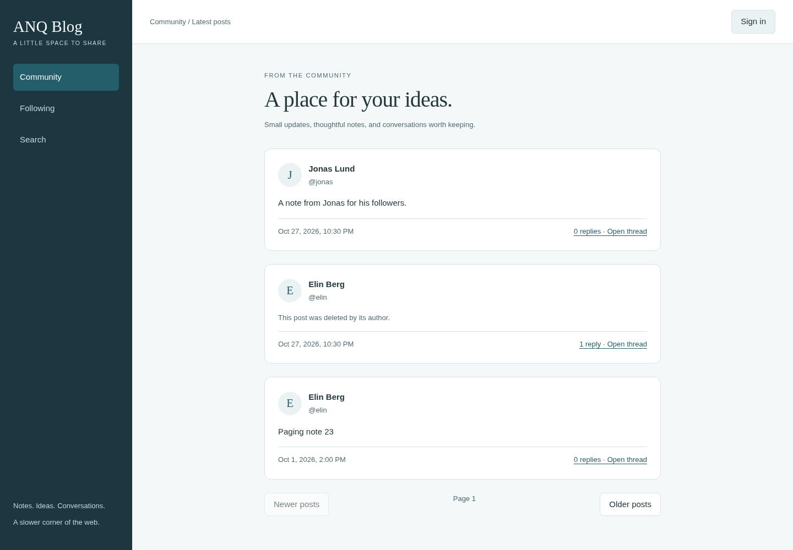
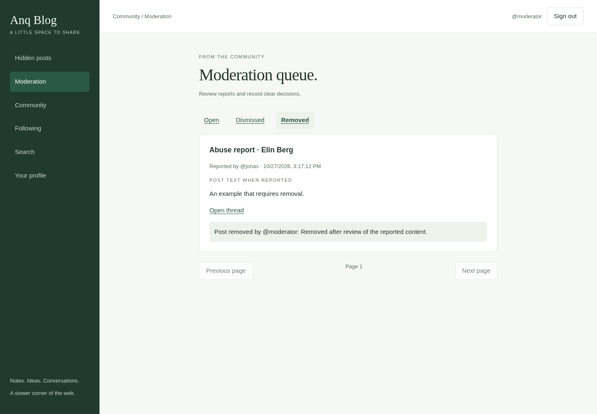

# ANQ Blog: rebuilding a small community application

The original ANQ Blog explored a broad social platform. This remake keeps a
smaller complete loop: publish a note, reply, follow a member, find a conversation,
and handle a report. It is built for a small community with administrator-created
accounts, rather than an open-registration social network.

## Implementation

React and TypeScript provide the interface, Fastify handles the HTTP API, and
PostgreSQL stores members, sessions, posts, follows, personal hides and reports.
The app serves its built interface and API from one process. SQL migrations are
explicit and transactional. Queries use bound parameters.

The code separates screens/components, HTTP/authentication and focused database
functions. Ordinary CSS variables hold the shared portfolio palette, spacing,
typography and component surfaces. Feed, search, profiles and threads reuse the
same post card. Pagination uses the same control across features. This keeps
visual changes small and avoids a separate component-package release process.

## Decisions worth examining

- Ownership is checked in SQL when changing posts. Version counters prevent an
  old browser tab from overwriting a newer edit.
- Public feeds use chronological cursor pagination. Cursor timestamps are built
  in PostgreSQL to preserve microseconds; UUIDs break ties consistently.
- Search uses literal, case-insensitive substring matching. There is no ranking
  service, fuzzy matching or extra index machinery at this scale.
- Personal hiding removes a post from that member's lists and redacts it in a
  direct read. It does not change another member's view. Hidden posts can be
  restored from a dedicated page.
- Reporting does not automatically hide or remove content. The report retains a
  snapshot of the text at submission, even if the author subsequently edits it.
- Moderator removal redacts the public text and prevents further edits/replies
  to that post. A placeholder preserves the existing thread. Stored text and
  report evidence remain available to authorized moderators/database operators.
- Decisions lock the report inside a transaction. Simultaneous reviewers cannot
  silently replace one another's decision. Each reviewed report records a note,
  reviewer and time. Different reports about one post are reviewed individually.

## Evidence

Integration tests use real PostgreSQL with isolated schemas, including cross-member
ownership, role gates, session expiry, stale edits, literal search, cursor ties,
report snapshots, per-member hiding, concurrent decisions and account provisioning.
Browser suites exercise separate reader/author/moderator sessions, persistence on
refresh, search navigation, decision history, mobile overflow and automated
accessibility scans. The actual Vite workspace is also smoke-tested without
modifying content. Test screenshots contain fictional records.

## Deliberate limits

One-level replies, text only, chronological feeds and administrator-created
accounts define v1. There are no likes, reposts, registration, password-reset
emails, uploads, realtime updates, ranking or delivered notifications. Moderation
is a small manual workflow, not an automated safety system. Decision history is
not tamper-proof against a database administrator. Accessibility scans are not a
complete manual audit. No performance or availability benchmark is claimed.

The disposable Ubuntu deployment also passed real HTTPS member workflows and
an encrypted off-host database recovery on the workstation. See
[deployment evidence](DEPLOYMENT.md). Public launch, independent review and real
community operation remain separate. The archived source and history are untouched.
